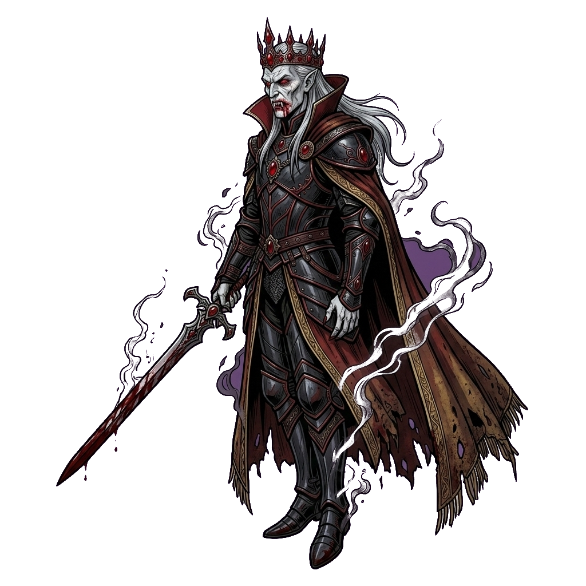
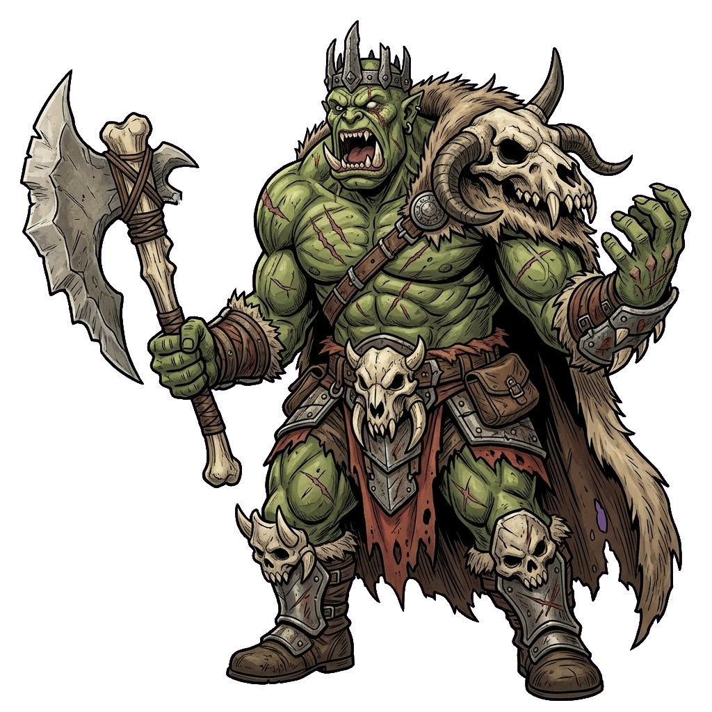
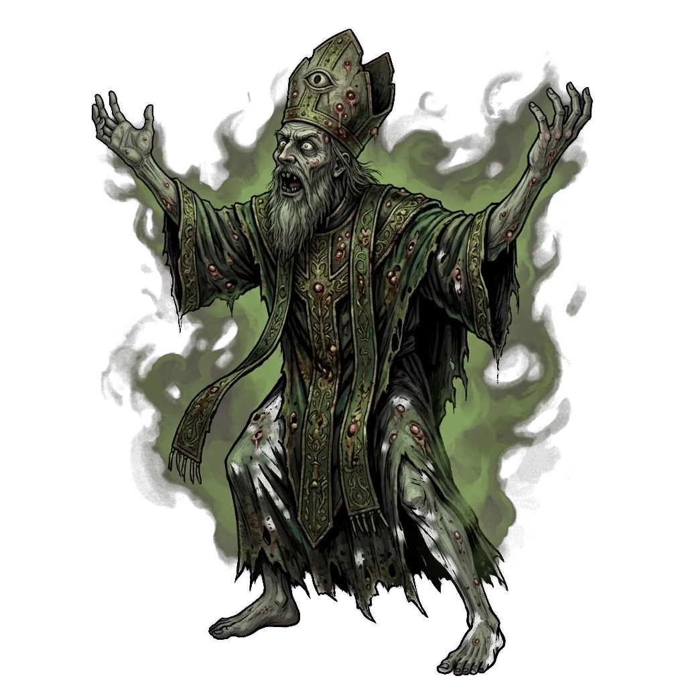
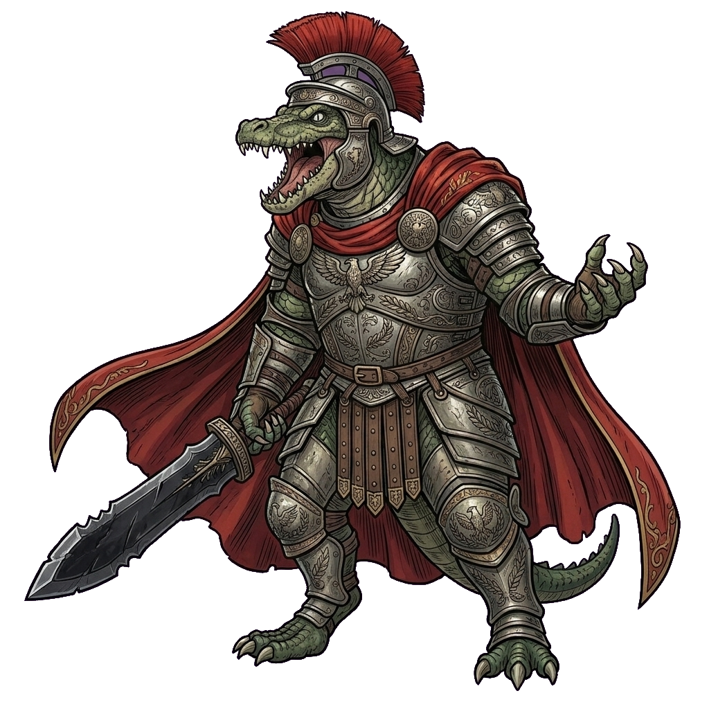
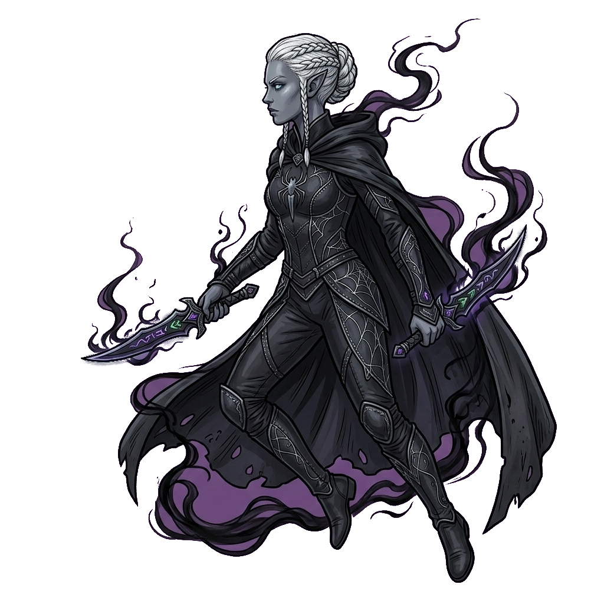
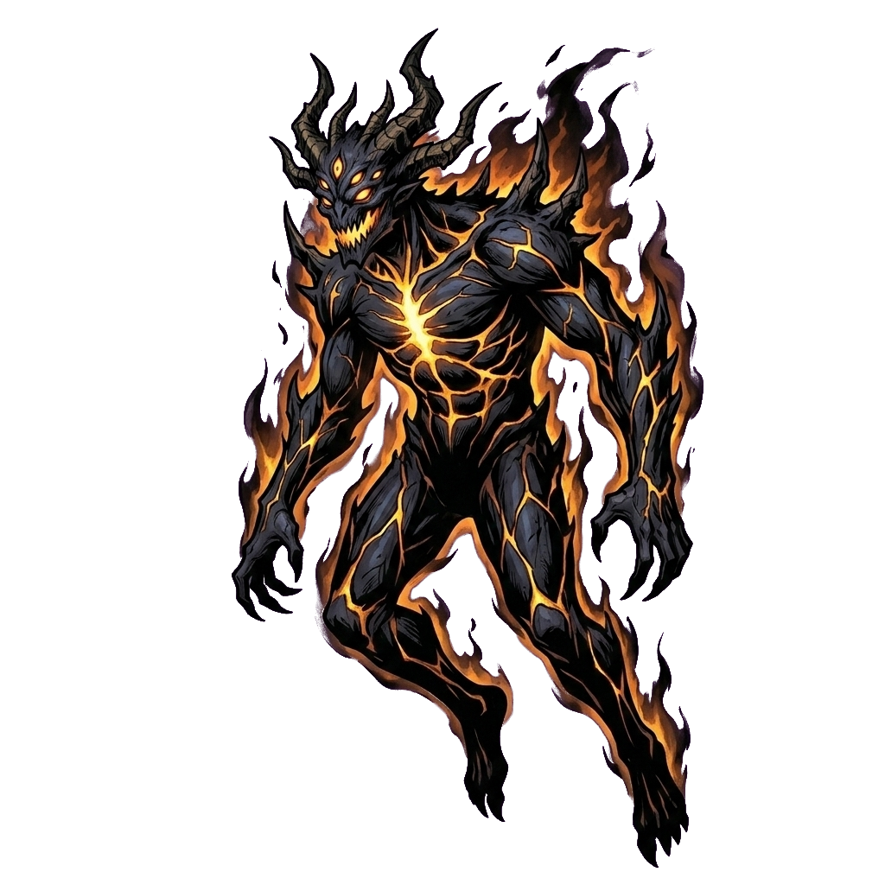

# Mercenary Brotherhood — Wiki

     

An unofficial, fan-made wiki for **Mercenary Brotherhood**, generated entirely from the game's own modding
data (`modding/reference_data`, the JSON the game runs on) and its unit and item art. It has a page for
every background, race, skill, ability, trait, enemy, item, settlement, dungeon, quest and more —
**3159 notes** covering all **3230** entries in the data, cross-linked so you can follow any connection
(an item to the enemies that drop it, a race to the backgrounds it can roll, a dungeon to its defenders).

## How to read it

The wiki is an [Obsidian](https://obsidian.md) vault. GitHub shows the pages as plain Markdown, but links
between pages and images only work in Obsidian:

1. Download this repository (**Code → Download ZIP**, or `git clone`).
2. In Obsidian choose **Open folder as vault** and pick the downloaded folder. No plugins are needed.
3. Start at **Home** ([Home.md](Home.md)).

## What's inside

| Area | Indexes |
|---|---|
| Characters | [Ascendant Paths](Indexes/Ascendant%20Paths.md) (8) · [Backgrounds](Indexes/Backgrounds.md) (115) · [Callings](Indexes/Callings.md) (5) · [Company Roles](Indexes/Company%20Roles.md) (10) · [Foundings](Indexes/Foundings.md) (6) · [Personalities](Indexes/Personalities.md) (12) · [Race-Background Combos](Indexes/Race-Background%20Combos.md) (31) · [Races](Indexes/Races.md) (26) · [Specializations](Indexes/Specializations.md) (60) |
| Combat | [Abilities](Indexes/Abilities.md) (286) · [Enemy Passives](Indexes/Enemy%20Passives.md) (89) · [Skill Traits](Indexes/Skill%20Traits.md) (422) · [Skills](Indexes/Skills.md) (52) · [Squad Archetype Families](Indexes/Squad%20Archetype%20Families.md) (15) · [Squad Archetypes](Indexes/Squad%20Archetypes.md) (75) · [Traits](Indexes/Traits.md) (418) |
| Enemies | [Arch-Villains](Indexes/Arch-Villains.md) (8) · [Encounter Tables](Indexes/Encounter%20Tables.md) (55) · [Enemies](Indexes/Enemies.md) (188) · [Enemy Variants](Indexes/Enemy%20Variants.md) (6) · [Factions](Indexes/Factions.md) (24) · [How Enemies Behave](Enemies/How%20Enemies%20Behave.md) (7) · [Vendetta Abilities](Indexes/Vendetta%20Abilities.md) (5) · [Vendetta Traits](Indexes/Vendetta%20Traits.md) (18) · [Vendetta Trophies](Enemies/Vendetta/Vendetta%20Trophies.md) (6) |
| Items | [Items](Indexes/Items.md) (309) · [Magic Properties](Indexes/Magic%20Properties.md) (477) |
| World | [Battle Events](Indexes/Battle%20Events.md) (6) · [Deities](Indexes/Deities.md) (8) · [Dungeon Rooms](Indexes/Dungeon%20Rooms.md) (9) · [Dungeons](Indexes/Dungeons.md) (29) · [Enemy Bases](Indexes/Enemy%20Bases.md) (38) · [Guilds](Indexes/Guilds.md) (10) · [Points of Interest](Indexes/Points%20of%20Interest.md) (13) · [Quest Chains](Indexes/Quest%20Chains.md) (5) · [Quests](Indexes/Quests.md) (51) · [Settlements](Indexes/Settlements.md) (270) |
| Mechanics | [Glossary](Mechanics/Glossary.md) · [Stats](Mechanics/Stats.md) · [Racial Relations](Mechanics/Racial%20Relations.md) |

Every page shows the data's own description verbatim, the numbers as stats tables, effects in plain
English, links to everything it references, a **Referenced by** section (who uses it), and the
developer's comments from the data in a collapsed *Developer notes* box.
[Coverage](_meta/Coverage.md) lists what was generated and what was left out and why;
[Unresolved References](_meta/Unresolved%20References.md) lists ids in the data that point at nothing.

## How it's made

Every page is produced by a script from the game's shipped modding data, so the whole wiki can be rebuilt
after each Early Access patch. The output is deterministic, so the commit history of this repository shows
exactly what each patch changed. Story text and translations stay packed in the game by design and are not
included. Don't edit generated pages here; they are overwritten on the next rebuild.

Game data, text and art belong to the developer of Mercenary Brotherhood.
